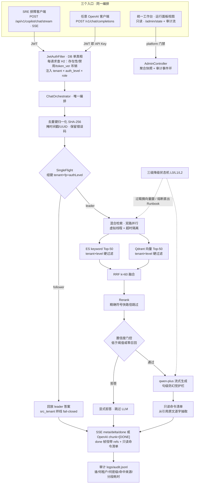

<div align="center">

# 🛡️ OpsShield

**面向 AIOps 与 SRE 场景的生产级 LLM 韧性治理与流量防御网关**

*告警风暴打不穿、模型挂了不雪崩、运维指令零幻觉。*

[](https://github.com/shing26/OpsShield/actions)
[](https://openjdk.org/)
[](https://spring.io/projects/spring-boot)
[](https://prometheus.io/)
[](#-测试体系与安全回归测试)
[](#-测试体系与安全回归测试)
[](LICENSE)

<p align="center">
  <a href="#-项目定位与核心立场">📖 项目定位</a> •
  <a href="#-30-秒版本">📊 30 秒版本</a> •
  <a href="#-系统架构与流量管道">🏗️ 系统架构</a> •
  <a href="#-快速开始">🚀 快速开始</a> •
  <a href="#-端点与可观测性矩阵">🖥️ 端点矩阵</a> •
  <a href="#-测试体系与安全回归测试">🧪 测试与验证</a> •
  <a href="#-架构决策记录">📐 架构决策</a>
</p>

</div>

---

## 📖 项目定位与核心立场

Java 21 虚拟线程 · ES 倒排 + Qdrant 向量双路召回（RRF 融合）· 双层缓存 · 三级自适应降级 · 多租户引擎层硬隔离 · 只读命令清单。

<p align="center">
  <a href="https://redis.io/"></a>
  <a href="https://qdrant.tech/"></a>
  <a href="https://www.elastic.co/elasticsearch"></a>
  <a href="https://jwt.io/"></a>
  <a href="https://developer.mozilla.org/en-US/docs/Web/API/Server-sent_events"></a>
  <a href="https://www.docker.com/"></a>
</p>

大模型进生产排障，撞的是四堵墙：**告警风暴**在数秒内打爆外部 API 配额、**模型依赖**让排障链路自身先雪崩、**指令幻觉**让值班的人照着编造的危险命令执行、**检索不精确**让通用向量检索丢掉错误码这类精确符号。OpsShield 架在监控告警入口与推理后端之间，是一道**只读、高可用、具备确定性兜底的 SRE 反向代理与流量防火墙**——所有排障请求都经过四道确定性防御阶段，而不是把裸告警流直接交给通用大模型。

> **核心立场（[ADR-0013](docs/adr/0013-trust-base-for-agents-not-an-agent.md)）**：OpsShield 是 agent 的**只读可信底座**，不是第 4 个 agent。权限是引擎层的数据过滤而非提示词约定；对目标系统零写操作、不设执行回路；"零幻觉"是**可静态判定的构造保证**，不是口头承诺。

**与 Agent 的关系**（ADR-0013 要求写进 README 的一条）：

- 它身上有三处 agent 形状——自举告警闭环（感知→上报→处置→停报）、三级降级状态机、置信度门控与显式拒答；但判据全是阈值与计数器，**没有一处是模型决策**；
- 多步 agent 可以把它当只读下游依赖调用（OpenAI 兼容面，JWT 即 Key），而它自己**不引入 LLM 决策循环与 tool-calling**；
- 更完整的自我定位——AIOps 五域三分类自证、与朴素 RAG 的五条机制级差异、给多步 agent 的调用契约——见 [docs/positioning-aiops.md](docs/positioning-aiops.md)。

---

## 📊 30 秒版本

大模型进生产排障，撞的是四堵墙，本网关各给一道防线：

| 生产痛点 | 防御机制 | 实测结果 |
| --- | --- | --- |
| **检索不精确**：通用向量检索丢错误码等精确符号，Top-1 不足 60% | 混合检索：ES 倒排 + 向量双路并行 + RRF 融合 + 精排，精确符号走快路径 | **精确码 Top-1 100%、语义 Top-3 100%**；hybrid 把语义 Top-1 **从 70.6% 拉到 88.2%**（68 样本 live） |
| **告警风暴**：一次集群故障掀起数千条同质告警，每条都触发 LLM | 堆栈去重键归一化 + 滑动窗口聚合计数 + 进程内并发合并（SingleFlight） | **500 并发同一去重键 → LLM 仅 1 次（削峰 99.8%）** |
| **模型依赖**：上游欠费/限流(429)/网络抖动，排障链路跟着雪崩 | 三级自适应降级状态机 + L1/L2 双层缓存 + 静态 Runbook 兜底，冷却后半开自愈 | **降级在真实负载下全链路行使过**（L0→L1→L2→L0 实录）；热点命中 TTFT **p99 16ms** |
| **指令幻觉**：模型编造高危运维命令，值班的人照着执行 | 只读命令清单从**本次引用的文档原文**逐字抽取（零生成面），四层只读策略过滤 | **契约命令 100% 逐字可溯源**（41/41）；答案错误码接地率 **100%**（live） |

> 三行数字均为 DashScope live 实测（embedding v3 + rerank v2 + qwen-plus），口径与复现命令见 [测试与验证](#-测试体系与安全回归测试)。无 key 时自动切本地 mock 后端——同代码路径复现机制正确性，但不承诺本表数字。权限底线：越权与 Prompt 越狱**零泄漏**（引擎层数据过滤，5 条越狱用例 live 实测）。

<details>
<summary><b>核心指标全表</b>（逐项口径与读表须知——引用任何数字前先读这段）</summary>

| 维度 | 目标 | 实测 | 口径 |
| --- | --- | --- | --- |
| 精确符号 Top-1 命中率 | 100% | **100%** | hybrid，34 错误码用例（live） |
| 语义 Top-3 召回率 | >90% | **100%** | hybrid，34 口语化用例（live） |
| 热点命中 TP99 | <50ms | **16ms** | L1 回放 n=200 的**服务端 TTFT**（回放不触外部 API）；端到端 p99=46.3ms 含本机 HTTP 栈开销——产物 [offline/load/reports/l1_hit_latency.md](offline/load/reports/l1_hit_latency.md) |
| 风暴 LLM 触发次数 | 500→1 | **1** | 500 并发同一去重键，llm_calls Δ=1（live） |
| 权限泄漏率 | 0 | **0** | 5 条越狱用例，引擎层过滤（live） |
| 场景 A 吞吐 | — | **88.4 req/s · 2492 请求 0 失败 · P50=16ms** | Locust 50 并发 30s（live，冷请求走真实 API；与随附 `locust_a_stats.csv` 一致） |

**读表三条口径**：① 以上均为 **DashScope live** 后端实测；mock 后端（key 留空自动切换，同代码路径）下**不承诺这些数字**。② 「场景 A 吞吐」与「风暴」**不是同一种负载**：前者是混合查询（80% 热 + 20% 冷），后者是**同一去重键的风暴**（全量去重、请求极快），且该行来自 2026-09-09 的运行（早于 P2 账号体系）——三者的数字不可互相推广。③ **live 独有的论证价值**：评测集显示语义查询 Top-1 `es_only` 仅 70.6% → hybrid 88.2%（语义 MRR 0.794→0.936）——样本越口语、纯词法腿越低，向量路的捞回越值钱；且扩语料/扩样时 `es_only` 腿漂移明显（当前 golden（68 样本，含口语极值与本机辖区系列）下 `es_only` 语义 Hit@3 91.2%、MRR 0.794，hybrid 逐位不变；历史扩语料曾让 `es_only` 语义 Hit@3 由 100% 降至 92%、MRR 0.813→0.767，hybrid 逐位不动）——**混合检索的稳健性正体现在这里**（E1 教训两次实测复现）。报告出处与生成时刻见 `offline/eval/reports/PROVENANCE.json`（内容摘要判据，CI 强制同代）。

</details>

---

## 🏗️ 系统架构与流量管道

OpsShield 位于监控告警入口与推理后端之间，所有进入系统的排障请求均经过四道确定性防御阶段：

```text
 [ Prometheus / Alertmanager / 微服务告警风暴 ]
        │
        ▼
 ① 流量整形与防击穿
       去重键归一化 FingerprintService（掩时间戳/UUID，保留错误码）
       滑动窗口聚合 SlidingWindowService · 进程内并发合并（SingleFlight）
        │
        ▼
 ② 多级检索与语义缓存
       L1 精确哈希（去重键级）· L2 Qdrant 向量语义
       ES 倒排 + Qdrant 向量双路并行 · RRF 融合 · 精排
        │
        ▼
 ③ 韧性状态机与安全门禁
       L0 全链路 ──▶ L1 摘向量腿 ──▶ L2 静态 Runbook 直出（零 LLM）
       句级防幻觉 VerbatimStreamFilter · 只读命令清单 ReadOnlyActionExtractor
        │
        ▼
 ④ 双出口可观测性
       SSE 流式问答 · OpenAI 兼容 /v1 面 · SRE 只读控制台
       Micrometer 单一事实源 ──▶ /actuator/prometheus 抓取面
```

三个入口（SSE 流式 / OpenAI 兼容面 / 统一工作台）共享同一条编排链路——这正是"两个协议面 + 一个工作台"语义一致的原因：



三级状态机：**L0 全链路 → L1 高负载（摘向量腿与 Rerank，退为纯 ES）→ L2 熔断（静态 Runbook 直出，零 LLM）**，冷却到期半开自探。降级的代价如实登记：L1 期语义 Top-1 由 88.2% 退到 70.6%、置信度门控退为"零召回级"（[ADR-0012](docs/adr/0012-degradation-cost-semantics.md)）；它在真实负载下被行使过——审计日志实录 `L0→L1（cause=inflight）→L2（cause=llm_failure）→L0（cause=cooldown_expired）`，对应压测档 u=48 在途峰值 151、期间最高档 L2（产物 [l1_trigger.md](offline/load/reports/l1_trigger.md)）。知识库重建走 blue/green 别名原子切流（[ADR-0006](docs/adr/0006-blue-green-alias-reingest.md)）：448 chunks 重灌 22.3s（live，服务端日志口径）、切流期间探针零中断，失败保留旧库在线。

### 三道防线，展开一点

**① 流量削峰（Traffic Shaping）**——去重键把"同一故障的不同变体"归一（掩时间戳/UUID，保留错误码身份），SingleFlight 让同一去重键的并发只放行一个 leader、其余回放，权限三元组（tenant+fp+authLevel）保证回放永不跨租户。10 条告警变体并发 → LLM 仅 1 次（[ADR-0003](docs/adr/0003-single-instance-inprocess-single-flight.md)）。

**② 韧性降级（Resilience）**——降级不是 catch 块，是状态机的一等公民：每次档位切换落审计事件（from/to/cause），过载降纯 ES、LLM 连续失败熔断直出预热 Runbook、冷却到期半开自探（曾实测修复过"熔断永不自愈"死锁）。指标以 `aiops.*` 层级名暴露 Prometheus，降级档位是 0/1/2 序数 gauge（[ADR-0016](docs/adr/0016-prometheus-metrics-exposure.md)）。

**③ 只读命令清单（Action Contract）**——答案下方附"下一步该跑什么"的可复制命令清单，但命令**不是模型生成的**：从本次引用的文档原文逐字抽出，四层只读策略把关（工具白名单 / 子动词闭集 / 外壳负载递归校验 / 旗标与重定向），认不出的形态判拒并计数。清单 ⊆ 引用是构造保证——**零幻觉是可静态判定的，不是承诺**（[ADR-0017](docs/adr/0017-read-only-action-contract.md)）。判据本身经安全回归测试验证过极性：改坏必红、复原必绿；线上行为由一套只读命令清单验证套件（contract verification suite）在真实流量上逐条复核，验证工具自身零写操作、连管理端点都不打。

**贯穿三道防线的两条底线**：权限是引擎层数据过滤不是提示词约定（越狱语料实测零泄漏，[ADR-0008](docs/adr/0008-permission-dimensions-on-every-shared-path.md)）；对目标系统零写操作、不设执行回路——它是 agent 的**只读可信底座**，不是第 4 个 agent（[ADR-0013](docs/adr/0013-trust-base-for-agents-not-an-agent.md)）。

---

## 🚀 快速开始

```bash
git clone https://github.com/shing26/OpsShield && cd OpsShield
bash scripts/quickstart.sh   # 生成随机凭据 .env（key 留空=mock）→ Docker 全栈 → seed 演示账号
bash scripts/demo.sh         # 预检全 PASS = 机制全链路就绪
```

起服务后的入口矩阵（控制台 / 排障页 / Prometheus / OpenAI 兼容面）见下一节 [端点与可观测性矩阵](#-端点与可观测性矩阵)。

<details>
<summary><b>零依赖试跑</b>（电脑上什么都没装也能起：不需要 Docker / Redis / Elasticsearch / Qdrant / API Key）</summary>

```bash
# 前置：打 jar 一次 + 建演示账号——两者都只依赖 JDK 21 + Maven，不需要任何中间件
mvn -q package -DskipTests
DEMO_PASSWORD=<自定口令> bash scripts/seed_demo_users.sh
STORAGE_MODE=memory DASHSCOPE_MODE=mock bash scripts/start_gateway.sh
# → 打开 http://localhost:8081/ ，右上角账号胶囊填 sre-full + 上面那个口令，默认视图就是排障台
```

`opspilot.storage.mode=memory` 把 ES / Qdrant / Redis 三者**全部**换成进程内实现
（[ADR-0022](docs/adr/0022-standalone-storage-mode.md)）：语料从 `offline/corpus/chunks.jsonl`
直接读进内存（本机实测 448 块 **约 0.2s**，170–204ms），检索仍是**两条腿 + RRF 融合**——词法腿与向量腿
打分方式不同，融合是真事，不是把同一份结果摆两遍。权限过滤走**与生产同一份**判据
（`IdentityFilter`），不是内存实现自己写的一套。

**这个模式不承诺任何检索质量数字**，这是它与 live 的诚实边界：

- 向量是**词法哈希**不是神经语义，精排是词面覆盖度不是交叉编码器；
- 因此**拒答门控的行为会变**——`DASHSCOPE_MODE=mock` 下域外提问（"今天天气怎么样"）不会被拒答，
  因为词法后端给任何文本都打出正分。实测对照：同一份内存语料换成真 key（`DASHSCOPE_MODE=live`），
  域外提问立刻恢复拒答。**这是模型轴的差异，不是存储轴的差异**；
- 想要完整演示（含拒答导航），用 `STORAGE_MODE=memory DASHSCOPE_MODE=live`；
  想完全离线，接受上面那条差异。

启动摘要与 `/api/v1/admin/health` 都会自报 `storage=memory` / `backend=in-memory`——
"我这次跑的是哪条链路"是一条可 grep 的事实，不靠人回忆启动命令。

</details>

<details>
<summary><b>发一次请求（OpenAI 兼容面，API Key = login 换来的 JWT）</b></summary>

```bash
set -a && . ./.env && set +a
TOKEN=$(curl -s -X POST http://localhost:8081/api/v1/auth/login \
  -H 'Content-Type: application/json' -d "{\"username\":\"sre-full\",\"password\":\"$DEMO_PASSWORD\"}" \
  | sed -E 's/.*"token":"([^"]+)".*/\1/')

curl -N http://localhost:8081/v1/chat/completions -H "Authorization: Bearer $TOKEN" \
  -H 'Content-Type: application/json' \
  -d '{"model":"opspilot","stream":true,"messages":[{"role":"user","content":"how to fix 50012_DB_TIMEOUT"}]}'
# → role 首帧 → content 增量帧 → 参考来源与只读命令清单注入 → finish_reason=stop → [DONE]
```

任何 OpenAI 标准客户端填 Base URL `http://localhost:8081/v1` + 上面的 TOKEN 即可直连。协议取舍（无状态单轮、溯源注入位置）见 [ADR-0007](docs/adr/0007-openai-compatible-surface-jwt-as-key.md)。

</details>

<details>
<summary><b>开发者路径</b>（宿主裸进程跑网关，需 JDK21 + Maven；与容器模式二选一，都占 8081）</summary>

```bash
cp .env.example .env   # DASHSCOPE_API_KEY（留空走 mock）、JWT_SECRET、DEMO_PASSWORD

docker compose up -d   # Redis + Qdrant + ES

cd offline && python3 -m venv .venv && .venv/bin/pip install pytest
.venv/bin/python chunkers/build_chunks.py && .venv/bin/python -m pytest tests/

mvn package -DskipTests && bash scripts/start_gateway.sh
bash scripts/seed_demo_users.sh

.venv/bin/python console_client.py "下单报 50012_DB_TIMEOUT 怎么排查"
.venv/bin/python console_client.py --storm --storm-n 500   # 告警风暴演示
```

（打包与启动分两步是硬要求：Windows 上 JVM 锁着 jar 时打包会产出截断 jar——顺序永远是停服 → 打包 → 起。）

</details>

---

## 🖥️ 端点与可观测性矩阵

OpsShield 把"系统活着"做成了结构化的入口矩阵（默认端口 `8081`，容器模式同为 8081）：

| 访问入口 | 协议 / 方式 | 功能描述 |
| --- | --- | --- |
| **SRE 统一工作台** | `GET /` | 一份页面、两个视图。默认是**排障台**：输入报警 → 只读命令清单置顶 + SSE 流式诊断 + 带序号溯源；右上角切**运行面板**：网关运行态、风暴抑制率、三级降级档位、多租户配额。同一份页面状态，排障一次就能看见右上角运行态数字变化（[ADR-0021](docs/adr/0021-unified-workbench-single-shell.md)） |
| **排障台旧地址** | `GET /troubleshoot.html` | 薄壳跳转到 `/`——旧链接、书签与文档里的地址继续可用，页面本体只有一份（[ADR-0021](docs/adr/0021-unified-workbench-single-shell.md)、[ADR-0020](docs/adr/0020-troubleshoot-console-operator-surface.md)） |
| **Prometheus 抓取面** | `GET /actuator/prometheus` | 导出 `aiops_*` 监控度量矩阵（不带凭证，由抓取侧网络策略兜住） |
| **OpenAI 兼容接口** | `POST /v1/chat/completions` | JWT 即 API Key；外部运维工具链、Dify、NextChat 或任意标准客户端填 Base URL 即可直连 |
| **SSE 排障流** | `POST /api/v1/copilot/chat/stream` | `meta/delta/done` 三帧；`done` 帧恒带引用来源与只读命令清单 |
| **覆盖范围** | `GET /api/v1/copilot/coverage` | 提问前可见的知识库边界：按调用者身份现算的**服务数 / 错误码数 / 语义块数 + 最近重建时间**，外加可点的服务名与错误码清单（点一下填进输入框）。拒答时同源给出"最接近的标识符"，让答不出来读成**边界**而非故障（[ADR-0023](docs/adr/0023-public-surface-terminology.md)） |
| **管理快照 / 审计流** | `GET /api/v1/admin/state` · `/api/v1/admin/audit/recent` | 运行面板视图与右上角健康抽屉的数据源；`role=platform ∧ auth_level≥3` 门禁，非平台身份渲染锁定态 |

#### 核心指标定义（`aiops.*` 层级名，Prometheus 侧点号转下划线）

* `aiops_storm_suppression_ratio`：告警风暴抑制率 = 被 SingleFlight 合并的请求数 / 总请求数；
* `aiops_cache_hit_rate`：双层缓存总命中率 = L1 与 L2 两层命中数之和 / 总请求数（L1 为去重键级精确命中，L2 为向量相似命中；`_l1_` / `_l2_` 分项分别导出）；
* `aiops_degradation_state`：降级档位序数 gauge，`0=NORMAL`、`1=CACHE_ONLY`、`2=SOP_FALLBACK`（实时读状态机，非 bind 时刻快照）；
* `aiops_guard_verbatim_masked`：流式导出中被出口护栏掩码的句数（按句累计，非按请求）；
* `aiops_guard_action_commands_rejected`：只读命令清单里被命令策略判拒的条数（判拒即丢弃，不静默）；
* 计数器另有 `aiops_llm_calls`、`aiops_llm_rate_limited`、`aiops_dedup_aggregated`、`aiops_cache_l1_hits`、`aiops_sop_fallbacks`、`aiops_guard_refusals` 等——全部由 Micrometer 单一事实源同时供控制台快照与抓取面两个出口（[ADR-0016](docs/adr/0016-prometheus-metrics-exposure.md)）。

---

## 🧪 测试体系与安全回归测试

防线不只靠单测——关键判据全部经"改坏必红、复原必绿"的安全回归测试，文档数字由门闩每次现算比对产物：

* **Java 294 单测**（`mvn test` 实跑全绿）：并发合并、状态机无损跃迁、AST 词法解析、双出口指标一致性、覆盖范围聚合、内存存储后端与身份过滤的跨后端对照；
* **Python 304 用例**（`pytest offline/tests/`）：含 `action_contract_probe.py` 的 **AC-1..AC-9 九组形式化不变式**——帧形状 / 逐字性 / 契约⊆引用闭包 / 段名闸 / 红线绊线 / 回放一致性 / 租户围栏 / 指标单调 / 反假绿覆盖；以及 `preset_probe.py` 的 **P-1..P-3 三组**——左栏预设与页面同源、预设形状（不锁产额）、覆盖范围与语料逐项相等；
* **安全回归测试**：契约探针 5 路（段名闸恒真、逐字恒真、红线恒空、闭包前置 None、AC-7 租户恒真——每条都有"改坏后 N failed / 复原后全绿"的实测记录）；文档门闩另有 A/B/C 三路（改文档数字、改产物、改写措辞，各须红）；
* **CI 五 job**（java / panel-contract / provenance / python / shell）零 key 零中间件可跑；`doc_numbers` 门闩现算比对 **23 条文档数字 / 37 处引用**，数字与产物分叉即 CI 红；评测报告与语料的同代性用内容摘要钉死（`provenance`，不用 checkout 会刷平的 mtime）；对外面用词由 `check_public_copy` 钉住（内部 canonical 词不得漏到本 README 与页面文案，词表从 `docs/CONTEXT.md` 现取）。

<details>
<summary><b>评测与压测：复现命令</b>（需活体栈 + 活体 key；数字底稿即各自产物）</summary>

```bash
cd offline
PY=.venv/bin/python          # Windows venv 为 .venv/Scripts/python.exe；或直接 bash ../scripts/py.sh 探测
$PY eval/build_golden.py     # 68 样本（34 精确码 + 34 语义）
$PY eval/evaluate.py         # 3 模式对比 + 越狱 → eval/reports/（报告自报服务端 live/mock 后端真相）
$PY eval/gate_matrix.py      # 门控误拒/漏拒率 + 阈值扫描 → eval/reports/gate_matrix.md
$PY eval/observed_probe.py   # 真实输入探测（无真值口径）→ eval/reports/observed_probe.md
$PY load/sweep.py            # 并发-延迟曲线（六档）→ load/reports/concurrency_sweep.md
$PY load/cache_savings.py    # 缓存节省账 → load/reports/cache_savings.md
.venv/bin/locust -f load/locustfile.py --headless -u 50 -t 30s --html load/reports/locust_a.html
SCENARIO=storm .venv/bin/locust -f load/locustfile.py --headless -u 500 -t 20s --html load/reports/locust_b.html
$PY load/l1_latency.py       # L1 回放延迟（热点命中口径）→ load/reports/l1_hit_latency.md
```

各脚本的口径与已知边界写在**各自的产物里**（例：`gate_matrix` 走 `/search` 故不含缓存、`cache_savings` 的未命中组必须真生成而非拒答）——引用前先读产物口径段，那是它们的单一事实源。实测产物目录：[offline/eval/reports/](offline/eval/reports/) 与 [offline/load/reports/](offline/load/reports/)，报告自报 live/mock 后端与生成时刻（`PROVENANCE.json`，CI 强制同代）。核心指标的历次扩语料基线与漂移实录（`es_only` 腿敏感、hybrid 稳健）都在报告里。

</details>

* **红队与缺陷台账**：五轮黑盒测评的完整缺陷-修复-回归锁记录在 [docs/qa/](docs/qa/)——两处 P0（组键缺租户的跨租户回放、admin 门禁把密级当信任域）都是红队真实触发后修复的，非纸面推演。
* **告警源自举（dogfooding）**：把项目自己的运行史当告警源——容器状态翻转 → 告警走完整编排链 → 检索命中自己写的复盘（[ADR-0011](docs/adr/0011-self-bootstrapped-alert-source.md)），实测"造容器 → SIGKILL → 告警 → 命中 rb-102 止损段"闭环。
* **证据一键打包**：`python scripts/pack_evidence.py` 产出逐项注明出处的快照（每个数字来自哪个文件、什么命令、当前模式能否复核）。

---

## 📐 架构决策记录

系统的演进过程严格遵从 ADR 机制，每篇含否决项与后果。关键决策索引如下（完整 **23 篇**见 [docs/adr/](docs/adr/)）：

| # | 决策 | 一句话理由 |
| --- | --- | --- |
| [0003](docs/adr/0003-single-instance-inprocess-single-flight.md) | 单机单实例部署，Single-Flight 用进程内 CompletableFuture | 7 天工期 + 本机压测场景下，多实例部署无收益 |
| [0006](docs/adr/0006-blue-green-alias-reingest.md) | 知识库重建走 blue/green 别名原子切流 | 切流期间探针零中断，失败保留旧库在线 |
| [0007](docs/adr/0007-openai-compatible-surface-jwt-as-key.md) | OpenAI 兼容协议面：JWT 即 API Key | 任意标准客户端零改造直连 |
| [0008](docs/adr/0008-permission-dimensions-on-every-shared-path.md) | 权限维度挂在每条共享路径上 | 引擎层数据过滤，不是提示词约定 |
| [0011](docs/adr/0011-self-bootstrapped-alert-source.md) | 告警源自举：把项目自己的运行史当告警源 | dogfooding 出真实闭环 |
| [0012](docs/adr/0012-degradation-cost-semantics.md) | 降级代价语义：L1 同时降质量与降门控——接受而非修 | 如实登记代价，而不是假装没有 |
| [0013](docs/adr/0013-trust-base-for-agents-not-an-agent.md) | 定位：agent 的可信底座，不是第 4 个 agent | 差异化恰恰建立在不引入 LLM 决策循环之上 |
| [0014](docs/adr/0014-streaming-verbatim-guard-sliding-buffer.md) | 流式出口防幻觉：句级滑动缓冲窗口 | 用打字机观感换可拦截性 |
| [0015](docs/adr/0015-distributed-primitives-interface-abstraction.md) | 单机极限与分布式一致性之间：三个风暴/降级原语的接口抽象 | 先留出演化接口，不提前背分布式成本 |
| [0016](docs/adr/0016-prometheus-metrics-exposure.md) | 指标面：从"面板快照"到"可被抓取" | Micrometer 单一事实源，两个出口一份数 |
| [0017](docs/adr/0017-read-only-action-contract.md) | 只读命令清单：只读、逐字抽取、fail-closed | 网关不执行任何命令；清单 ⊆ 引用是构造保证 |
| [0021](docs/adr/0021-unified-workbench-single-shell.md) | 统一工作台：一个壳、两个面，抽屉按身份分级 | 排障时同屏看见运行态；不新开非 admin 状态端点 |
| [0022](docs/adr/0022-standalone-storage-mode.md) | 零依赖试跑：显式开关，不自动回退 | 中间件可达性会抖，自动回退会产出"假绿"实例 |
| [0023](docs/adr/0023-public-surface-terminology.md) | 对外面：术语双轨、双向门闩、覆盖范围声明 | 内部精确术语不外泄；覆盖边界按身份过滤、现算 |

---

## 🗺️ 仓库导航

| 你想… | 去哪 |
| --- | --- |
| 判断这个项目值不值得看 | 本文（读完即可） |
| 了解它的定位边界与差异化 | [docs/positioning-aiops.md](docs/positioning-aiops.md) |
| 起服务 / 跑演示 / 录屏 | [docs/DEMO.md](docs/DEMO.md) |
| 日常运维、脚本索引、**债务触发线** | [OPS.md](OPS.md)（脚本按"服务生命周期 / 门禁检查 / 故障注入与演示"分组索引） |
| 领域词汇 | [docs/CONTEXT.md](docs/CONTEXT.md) |
| 目录地图 / 逐包职责 / 维护者向内容 | [docs/repo-map.md](docs/repo-map.md) |
| 架构决策与否决理由 | [docs/adr/](docs/adr/)（17 篇，每篇含否决项与后果） |

---

## 🏷️ 命名空间与许可

* **OpsShield**：项目的官方对外名称，代表为 SRE 智能运维构筑的"韧性防御护盾"；
* **opspilot**：系统的内部工程代号与代码命名空间——Java 包名 `com.opspilot`、配置前缀 `opspilot.*`、`/v1` 协议的 model 名 `opspilot`。展示名与命名空间解耦是开源基础设施的常见形态，改名不触碰任何代码与配置。

本项目基于 [MIT](LICENSE) 开源发布。

<p align="center"><sub>MIT © 2026 shing26 · 为受够告警风暴与模型雪崩的 SRE 而建</sub></p>
